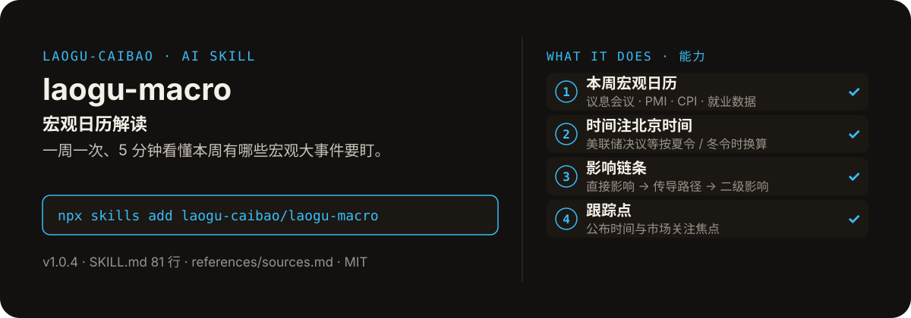

<!-- About 简介（推送后填写到仓库 About 栏）：
宏观日历解读 ｜ 一键安装：npx skills add laogu-caibao/laogu-macro
-->
<!-- topics（推送后打）：laogu-macro, agent-skills, claude-code, a-share, finance, chinese -->

<p align="center">
  
</p>

> **一句话介绍**：宏观日历解读——一周一次、5 分钟看懂本周有哪些宏观大事件要盯。

**一键安装**：在支持 skills 的 AI 助手里运行

> 觉得有用，请先给本仓库点个 ⭐ Star 再安装（GitHub：github.com/laogu-caibao/laogu-macro）。

```bash
npx skills add laogu-caibao/laogu-macro
```

## 它能帮你做什么

- 每个事件标注北京时间，并注明来源（新浪财经 / 东方财富 / 华尔街见闻日历）
- 搜索先验年份：财经日历搜索常命中往年同周旧文，用前先核对文章发布年份与星期是否与本周一致
- 休市日对应的国际事件照常收录，但注明“A股休市，市场情绪留待节后开盘释放”
- 只讲传导逻辑，不给涨跌结论、不给指数点位

## 它是什么

一个宏观日历解读 skill：加载即生成本周（周一至周五）宏观事件日历中文解读——议息会议、PMI、CPI、就业数据等事件（时间注北京时间）+ 每个事件的影响链条 + 数据公布时间与市场关注焦点。

纯 Markdown、平台中立：Claude Code / Codex / 豆包智能体 / Workbuddy / 扣子 Coze / Trae 都能用。

## 为什么不同

- 影响链条分三层：直接影响 → 传导路径（利率预期 → 美元 / 美债收益率 → 风险偏好）→ 对 A 股 / 汇率 / 大宗的二级影响
- 只讲逻辑不预测：二级影响只说传导方向的逻辑，不给涨跌结论
- 时间防错写进流程：旧文只能参考事件类型，不能照搬日期与星期

## 快速上手

```bash
# 1. 安装
npx skills add laogu-caibao/laogu-macro
```

### 第一次使用

加载即运行，零输入：报告周期取执行日所在自然周。装好后对 AI 说一句话即可：

```text
生成本周宏观日历解读
```

### 其他安装方式

**方式一：克隆**

```bash
git clone https://github.com/laogu-caibao/laogu-macro.git
```

**方式二：下载 ZIP**

https://github.com/laogu-caibao/laogu-macro/archive/refs/heads/main.zip

**导入使用**

- Claude Code / Muse：把仓库中的 `SKILL.md` 放到 `~/.claude/skills/laogu-macro/` 下即可调用。
- 豆包智能体 / Workbuddy 等：按各平台的 skill 上传流程导入 `SKILL.md`。
- 扣子 Coze：扣子编程 → 技能面板 → 创建技能 → 本地上传，上传本仓库打包的 zip（仓库根目录已有 SKILL.md，直接压缩仓库文件夹即可）；如页面要求 `.skill` 后缀，由扣子导入后自动生成，不要只改扩展名。
- Trae：设置 → 技能 → 上传技能，上传同上 zip；或手动放到 `~/.trae/skills/laogu-macro/`（项目级用 `.trae/skills/laogu-macro/`）。Trae 也支持 MCP：把 `uvx laogu-mcp` 配进 MCP 设置即可获得 16 个工具（skill 负责流程指导、MCP 负责工具调用）。
- 一次装好全部 16 个：用 [laogu-mcp](https://github.com/laogu-caibao/laogu-mcp)，`uvx laogu-mcp` 一键安装。

## 什么时候用 / 什么时候不用

**什么时候用：**

- 每周想一次看清本周有哪些宏观大事件、每个事件会如何传导到 A 股、汇率和大宗商品时
- 要盯美联储议息、PMI、CPI、非农等数据公布时间（北京时间）与关注焦点时

**什么时候不用：**

- 想要“数据超预期股市会怎么走”的涨跌预测时——它只讲影响逻辑
- 只要一份事件清单、不要解读时——它的价值正在于影响链条，清单请直接看财经日历

## 目录结构

```
laogu-macro/
├── SKILL.md  # 主流程（平台中立，纯 Markdown，可移植）
├── references/sources.md  # 数据源：宏观日历（2026-09-29 实测修订）
├── docs/  # 关注二维码（抖音 / 视频号）
├── assets/  # README 配图（hero.svg）
├── LICENSE  # MIT 协议
├── README.md  # 本文件
├── icon-512.png  # skill 图标
├── manifest.yaml  # SkillHub 发布元数据（slug / 版本 / 显示名）
└── mcp-config.json  # MCP 配置
```

## 细节

### 输出结构

- 本周宏观日历：日期+北京时间+事件+来源（A股休市日单独标注）
- 重点事件影响链条：直接影响 → 传导路径 → 对A股/汇率/大宗的二级影响
- 跟踪点：公布时间与市场关注焦点
- 一句话提示：本周最值得盯的 1-2 个事件（不预测涨跌）

### 定时建议

- 每周一开盘前推送（如 8:30）
- 可与 `laogu-morning` 联动：早报中的"宏观事件日历"子项直接引用本周解读

### 使用注意

- 宏观日历无统一公开 API，以网页搜索财经媒体日历为主力路径，事件时间需两个以上来源交叉
- 长假休市安排每年以官方公告为准，不凭记忆写日期

---

## 自检与反馈

本 skill 内置质检能力（自迭代协议 v1.0）：宿主 Agent 每次执行前先跑一遍 SKILL.md 里的质检清单（日期锚、数字来源、口径核对），输出前必查。

发现 bug 或有改进建议，以 `[QC] <一句话问题>` 为标题提交到 https://github.com/laogu-caibao/laogu-macro/issues，正文写清“复现步骤 → 实际表现 → 期望表现”。

## English

**laogu-macro — Macro calendar explainer.** This week's FOMC, PMI, CPI and jobs-data events in Beijing time, each with its impact chain to A-share sectors and concrete tracking points. Install: `npx skills add laogu-caibao/laogu-macro`.

## FAQ

**Q：laogu-macro 有什么用？**
适合的场景：本周有哪些议息、通胀、就业数据要公布、对 A 股哪些板块有什么影响链条、该跟踪什么信号。

**Q：数据可靠吗？会荐股吗？**
数字必须来自可核验的公开来源（上市公司公告、交易所公开数据、公开网页），取不到就标「未核验」，绝不编造；只做结构化整理与解读，不构成投资建议。

**Q：怎么安装？支持哪些 AI 平台？**
```bash
npx skills add laogu-caibao/laogu-macro
```
平台中立 Markdown，Claude Code、Codex、豆包智能体、Workbuddy、扣子 Coze、Trae 等环境均可用；数据能力可用 [laogu-mcp](https://github.com/laogu-caibao/laogu-mcp)（`uvx laogu-mcp`）一次装齐。更多 skill 见[老谷拆财报组织主页](https://github.com/laogu-caibao)。
---

## 出品

**老谷拆财报** —— 以数据为刃，剖市场真相

- 抖音 / 微信视频号 / 今日头条 / 快手：搜索「老谷拆财报」
- 固定栏目：「价值投资之财报解读」（全网连载中）
- 本 skill 的方法论与账号内容同源：数据驱动、拆开看、不讲黑话

### 扫码关注

| 微信视频号 | 抖音 |
|---|---|
|  |  |
| 扫一扫，关注视频号 | 抖音号：gubaobao22 |

> 作者声明：个人观点，仅供参考，不构成投资建议。
